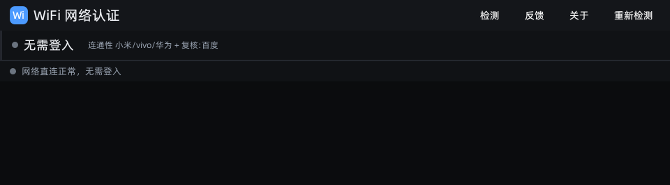
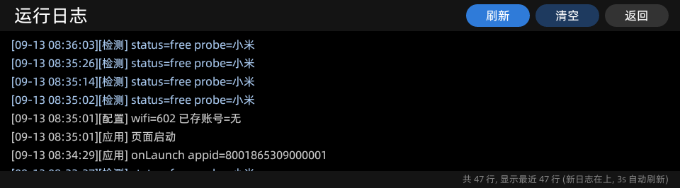
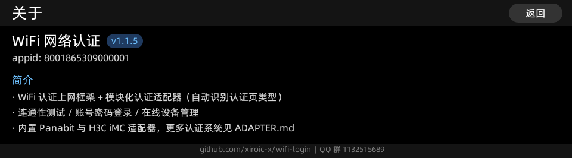
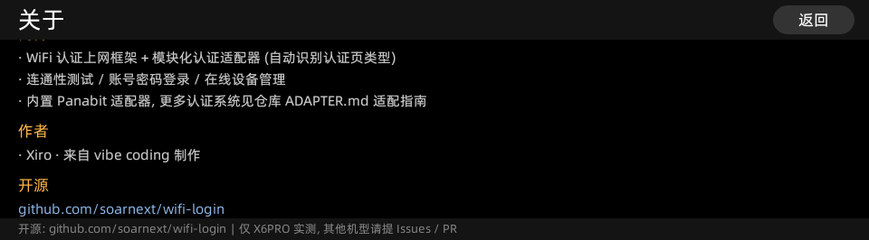

<div align="center">

# 📶 WiFi 网络认证（有道词典笔）

**给有道词典笔用的 WiFi 登录器** —— 替代打不开、体验差的认证网页，
在 960×266 横条屏上完成 **检测 → 登录 → 在线设备管理**。

[](https://github.com/xiroic-x/wifi-login/actions/workflows/build.yml)
[](https://github.com/xiroic-x/wifi-login/releases)
[](LICENSE)
[](#-设备兼容性与平台)

[功能](#-功能) · [快速开始](#-快速开始) · [连通性判定](#-连通性判定为什么会显示无需登入) ·
[常见问题](#-常见问题) · [适配器开发](ADAPTER.md) · [文档导航](#-文档导航)

</div>

---

## 📷 界面

960×266 横条屏、纯黑主题（X6PRO 真机实拍）：

| 主页面 | 日志页 |
| --- | --- |
|  |  |

| 关于页 | 关于页（作者 / 开源） |
| --- | --- |
|  |  |

## ✨ 功能

- **认证框架 + 模块化适配器**：本体不含任何具体认证协议，协议收在
  `ui/src/services/portal-adapters/` 下的适配器模块（必选 `match` /
  `loadConf` / `login`，可选 `queryStat` / `logout` /
  `sync` / `listDevices` / `offOne` / `offAll`）；
  适配器提供 `listDevices` 才显示「设备管理」入口。内置 **Panabit** 适配器作为默认实现与模板。
- **认证页类型自动识别**：按跳转 URL 参数 / 页面标题 / 内容 / 响应头打分取最高分；
  认不出则回退该 WiFi 上次成功的适配器，再不行让用户手选认证类型、手填服务器地址。
- **连通性检测**：小米 / vivo / 华为三个 `generate_204` 端点并发，
  **204 只当证据**，还必须用非探测源站点复核通过才判「无需登入」（见下方专节）。
- **账号密码登录**：Panabit `webauth/user_login`，密码 AES-128-ECB/ZeroPadding
  （密钥 `Panabit@1024_key`，与网页端 `pa_aes_encode` 一致）。
- **在线设备管理**：设备列表（设备名 / IP / MAC / 在线时长，自动标记「本机」）、
  单台下线（`user_offone`，`addr` 是目标设备在线 IP）、全部下线；15 秒自动刷新。
- **记住密码按 WiFi 隔离**：`$dataDir/wifi_account.json` 结构
  `{ version:2, accounts:{ "<ssid>": {...} } }`，密码 AES 密文落盘、界面只显示圆点掩码，
  换网络不会串用上一个网络的账号。
- **会话保活与自愈**：登录前自动 `load_portal_conf` 刷新会话、认证页 30 秒心跳、
  会话过期类失败自动刷新重试一次（密码错 255 / 锁定 3 / 需改密 2 不重试）、
  切后台超 90 秒回前台自动重检、从管理页返回立即重检。
- **前后台切换不冲突**：每次重检 `abort` 上一次在途探测；系统输入法面板引起的
  onHide/onShow 被识别抑制；定时器随页面统一释放。

## 🚀 快速开始

从 [Releases](https://github.com/xiroic-x/wifi-login/releases) 下载**对应平台**的 AMR
（`-rk` = RK3562 机型，`-cvi` = CVITEK 机型），推到笔上安装：

```sh
adb push 8001865309000001.<版本>-rk.amr /data/local/tmp/
adb shell "miniapp_cli install /data/local/tmp/8001865309000001.<版本>-rk.amr"
adb shell "miniapp_cli start 8001865309000001"      # 不带 --page 才进主页
```

装好后联网即可：检测到需要认证会自动出现登录表单，填账密点「登 录」。
运行日志 `/userdisk/xiro/wifi.log`，机器可读状态 `/userdisk/xiro/status.json`。

> 覆盖安装同一 appid 不会重新解包 `libs/*.so`；要让包内原生插件生效，先
> `miniapp_cli uninstall 8001865309000001` 再 install。

## 🔍 连通性判定：为什么会显示「无需登入」

「无需登入」是一个**结论**，不是猜测。判定分两阶段：

1. **并发探测**：三个国内连网检测端点同时请求。`204 + 空包体` 只算 **free 证据**；
   出现任何门户证据（`3xx + Location`、被改写的响应体、非 204 空包体、无有效状态码）
   立刻判 **需要认证** —— 门户证据优先，不受「谁先返回」影响。
2. **非探测源复核**：拿到 204 证据后，再用**不是探测源**的普通站点（百度 / 腾讯）复核：
   任一复核成功才报「无需登入」，并把复核站点记进结果（`confirm`）与日志
   （`confirm=` / `freeCount=`）；复核被拦截判需要认证；复核不通则如实报
   「无网络连接」并给出原因。

> **为什么要复核**：部分网关会对连网检测端点免认证放行（探测源能通、通用网络不通）。
> 只看 204 就会误报「无需登入」，而且界面还会把登录表单藏起来 —— 这正是 v1.1.3 修掉的问题。

## 📘 外部调用（给其它小程序）

```js
// 检测：结果经事件回传，默认事件名 wifiCheckResult，可用 callback 指定
$falcon.navTo('falcon://8001865309000001/index', { action: 'check' })

// 登录：预填凭据 + 自动提交
$falcon.navTo('falcon://8001865309000001/index', {
  action: 'login', server: '10.0.0.10:8080',
  username: 'xxx', password: 'xxx', remember: '1', auto: '1',
})

// 日志页
$falcon.navTo('falcon://8001865309000001/index', { action: 'log' })
```

完整参数、回调 JSON 与 `status.json` 字段见 [docs/external-api.md](docs/external-api.md)。

## 📱 设备兼容性与平台

两个硬件平台的**页面 / UI / 适配器代码完全一致**，差异全部收在
`ui/src/services/platform/` 平台实现层；CI 分别构建并区分命名。

| 平台 | 机型 | 状态 | 产物 |
| --- | --- | --- | --- |
| **RK3562**（ARM / aarch64） | 有道词典笔 X6PRO | ✅ 已实测 | `<appid>.<版本>-rk.amr` |
| **CVITEK**（RISC-V C906） | 搭载 CVI 芯片的机型 | ⚠️ 代码就绪，**待真机验证** | `<appid>.<版本>-cvi.amr` |

| 能力 | RK 版 | CVI 版 |
| --- | --- | --- |
| 网络请求 | 自研 `panet` 原生库（随包打进 `.so`） | 固件原生 `$jsapi/http` |
| 账号存储 | 文件 `$dataDir/wifi_account.json` | 原生 `$jsapi/system_kv` |
| 运行日志 | 落盘 `/userdisk/xiro/wifi.log` | 内存缓冲（应用内可看，重启清空） |
| 状态写盘 | `/userdisk/xiro/status.json` | 无文件模块，跳过 |
| WiFi 名称（按网隔离） | 原生 `panet.wifiSsid()` | 无对应 API，回退「最近使用」槽位 |

CVI 适配依据官方引擎库 [yocop/iot_miniapp_sdk](https://gitee.com/yocop/iot_miniapp_sdk)
分析实现，尚无真机验证；CVI 机型请下载 `-cvi` 产物，遇问题附机型与日志提 Issue。

## 🛠 开发与测试

- **构建走 CI**：推送 `main` 或打 `v*` 标签触发
  [build.yml](.github/workflows/build.yml) —— 交叉编译 `native/panet`（aarch64）→
  `pnpm -C ui package` → 产出 `-rk` / `-cvi` 两个平台的 AMR。
  本地通常没有 aarch64 工具链，包里的 `libs/libjsapi_panet.so` 由 CI 生成。
- **本地测试（多进程并行）**：

```sh
node test/run-all.mjs      # 每个 .test.mjs 各自独立进程并行跑, 汇总结果与耗时
```

  覆盖纯逻辑（检测 / 适配器 / 存储 / AES）、挂起与 abort 防护，以及**设备模拟测试**：
  `test/sim-gateway.test.mjs` 在子进程里跑 `test/mock-gateway.mjs` 模拟真实网关，
  覆盖 正常网络 / 网关免认证放行 / 未认证全拦截 / 透明改写 / 复核不可达 五种形态。
  `test/` 不入库。

```
native/panet/       自研 panet 原生库 (request / writeFile / appendFile / readFile / mkdirs / wifiSsid)
ui/src/pages/       index / management / log / about
ui/src/services/    detect 检测 · net 适配层 · store 存储 · portal-adapters 适配器 · platform 平台层
profiles/           设备画像 (X6PRO 真机实测结论)
docs/               外部接口 / Panabit 协议 / 工程说明
```

## ❓ 常见问题

<details>
<summary><b>显示「无需登入」，但实际还是上不了网？</b></summary>

v1.1.3 起「无需登入」必须先通过非探测源复核（见
[连通性判定](#-连通性判定为什么会显示无需登入)），复核不通会如实报「无网络连接」并附原因。
若仍有异常：先点顶栏「重新检测」；仍不行请附 `/userdisk/xiro/wifi.log` 与
`status.json` 提 Issue —— 日志里 `status=free` 会带 `confirm=` 与
`freeCount=`，能直接看出复核依据。

</details>

<details>
<summary><b>登录失败返回的 `code` 是什么意思？</b></summary>

Panabit：`0` 成功、`200` 该设备免认证已通过、`255` 账号或密码错误、
`3` 锁定（消息里带剩余秒数）、`2` 需在网页认证页改密。
其它 `code` 会原样显示（例如 `服务器返回 code=1`），便于对照网关侧策略排查。

</details>

<details>
<summary><b>认不出认证类型 / 不知道服务器地址？</b></summary>

界面会显示「认证类型」选择行：先手选适配器；仍不行会出现服务器输入行，
手填 `IP[:端口]` 后点「确 定」即可继续登录。

</details>

<details>
<summary><b>为什么截图是坏的 / 页面没起来？</b></summary>

部分固件的 `miniapp_cli capture` 产出无效图（真机实测恒为 1130 字节），
排查请以日志与 `status.json` 为准。屏幕休眠时 `miniapp_cli start` 只写
`onLaunch`、不执行页面启动，唤醒屏幕后再启动才能看到「页面启动」。

</details>

## 📚 文档导航

| 文档 | 内容 |
| --- | --- |
| [ADAPTER.md](ADAPTER.md) | 适配器模块开发指南：接口契约 + 从登录页提取协议 + 全流程 |
| [SKILL.md](SKILL.md) | 配套 skill：从网站分析到做出适配器的流程要求 |
| [docs/external-api.md](docs/external-api.md) | 外部小程序调用、设备管理页拉起、`status.json`、日志 |
| [docs/panabit-api.md](docs/panabit-api.md) | Panabit Portal API（端点 / 参数 / 返回码 / 密码加密） |
| [docs/project.md](docs/project.md) | 工程结构、构建（CI 与本地）、版本与产物命名 |
| [CHANGELOG.md](CHANGELOG.md) | 更新日志（CI 发版时按版本抽取为 Release Notes） |

## 🤝 反馈与贡献

- **提 Issue**：[Bug 反馈 / 添加认证适配器 模板](https://github.com/xiroic-x/wifi-login/issues/new/choose)
  —— Bug 请附机型 / 版本 / 复现步骤 / 日志 `/userdisk/xiro/wifi.log` / 截图；
  适配新认证系统请按 [ADAPTER.md](ADAPTER.md) 提取登录页与管理页源码后提交。
- **Pull Request** 合并前提：
  1. **不得影响 X6PRO 上已验证的现有功能** —— 这是唯一的基准机型；
  2. 机型差异用能力探测做分支（`panet` 方法是否存在、屏幕尺寸、jsapi 可用性），
     不要直接改通用逻辑；
  3. 涉及屏幕尺寸的改动必须同时适配 960×266。

## ⚖️ 开源许可

**分层许可**（完整条款见 [LICENSE](LICENSE)）：

| 范围 | 许可 |
| --- | --- |
| `ui/src/services/portal-adapters/`（认证适配器模块） | **MIT** |
| `ui/src/services/platform/`（平台实现层） | **MIT** |
| 其余全部代码（默认） | **GNU GPLv3** |

- **MIT 目录**是面向第三方开发者的扩展点：适配新认证系统、移植新硬件平台可自由复用
  （含商用），只需保留版权声明 —— 见 [ADAPTER.md](ADAPTER.md) 与 [docs/project.md](docs/project.md)；
- **GPLv3** 覆盖框架本体（页面 / 检测 / 存储 / UI / 构建），二次开发须以相同许可开源；
- 第三方依赖与资源各有其自带许可，使用时请一并遵守；提交 Issue / PR 即表示同意所贡献内容
  以上述对应许可发布。
