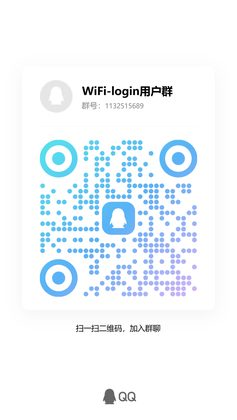

<div align="center">

# 📶 WiFi 网络认证

**有道词典笔上的 WiFi 认证助手** —— 不用再跟打不开、点不动的认证网页较劲。

检测连通性 → 账号登录 → 在线设备管理，一个页面走完；**横条屏与竖屏全面屏都自适应**。

[](https://github.com/xiroic-x/wifi-login/actions/workflows/build.yml)
[](https://github.com/xiroic-x/wifi-login/releases)
[](LICENSE)
[](#-支持机型与产物)

[功能](#-功能) · [机型与产物](#-支持机型与产物) · [安装](#-安装) · [使用](#-使用) ·
[兼容性判定](#-兼容性检测怎么得出的结论) · [常见问题](#-常见问题) · [适配器开发](ADAPTER.md)

</div>

---

## ✨ 功能

- **认证框架 + 模块化适配器**：本体不含任何具体认证协议，协议收在
  `ui/src/services/portal-adapters/` 下的适配器模块（必选 `match` /
  `loadConf` / `login`，可选 `queryStat` / `logout` /
  `sync` / `listDevices` / `offOne` / `offAll` / `keepAlive`）；
  适配器提供 `listDevices` 才显示「设备管理」入口，声明 `keepAlive` 才在「已认证」后继续心跳。
  内置 **Panabit**（默认实现与模板）与 **H3C iMC Portal** 两个适配器。
- **认证页类型自动识别**：按跳转 URL 参数 / 页面标题 / 内容 / 响应头打分取最高分；
  认不出则回退该 WiFi 上次成功的适配器，再不行让用户手选认证类型、手填服务器地址。
- **连通性检测**：小米 / vivo / 华为三个 `generate_204` 端点并发，
  **204 只当证据**，还必须用非探测源站点复核通过才判「无需登入」（见下方专节）。
- **账号密码登录（Panabit）**：`webauth/user_login`，密码 AES-128-ECB/ZeroPadding
  （密钥 `Panabit@1024_key`，与网页端 `pa_aes_encode` 一致）。
- **账号密码登录（H3C iMC 门户）**：适配形如
  `http://<门户>:8080/portal/?userip=…&userurl=…` 的校园 / 企业网页认证；
  登录 `pws?t=li`（密码 `base64` 后再 URL 编码），响应 `base64→percent→JSON`，
  `630xx` 业务码本地映射中文；登录成功后按 `heartBeatCyc` 发送 `doHeartBeat.jsp` 保活
  （`keepAlive`；仅在应用主页前台运行期间发送，切后台暂停、回前台自动恢复），
  避免网页关闭后被踢下线；支持 `pws?t=lo` 下线。
  iMC 门户页没有在线设备列表接口，故不提供设备管理入口。
  协议取证与真机排障见 [docs/h3c-imc-portal.md](docs/h3c-imc-portal.md)。
- **在线设备管理（Panabit）**：设备列表（设备名 / IP / MAC / 在线时长，自动标记「本机」）、
  单台下线（`user_offone`，`addr` 是目标设备在线 IP）、全部下线；15 秒自动刷新。
- **记住密码按网络隔离**：按当前网络名分别保存（结构 `{ version:2, accounts:{ "<ssid>": {...} } }`），
  换网络不会串用上一个网络的账号；保存后**回读校验**并写日志，密码在界面上只显示圆点掩码。
- **功能检测页**：一眼看清系统版本、固件给了哪些能力、本应用是否兼容，并给出可留档的文本报告。
- **数据清理页**：清理前明确告诉你**会删掉哪些东西**（全部已保存账号），二次确认才执行。
- **旧数据自动迁移**：升级后历史位置的数据自动并入应用数据目录，迁移完成会提示一次。
- **兼容性检测**：启动时对存储（写—读回环）/ 页面基类 / 原生扩展 / 网络逐项真实调用，
  给出「兼容 / 兼容（降级）/ 不兼容」三档判定，写日志并在主页与检测页展示；
  判据是能力实测而非机型白名单，新机型无需改代码即可得到结论。
- **会话保活与自愈**：登录前刷新门户会话、30 秒状态心跳、
  会话过期类失败自动刷新重试一次（密码错 / 锁定 / 需改密等业务错误不重试）、
  切后台超 90 秒回前台自动重检、从管理页返回立即重检。
- **前后台切换不冲突**：每次重检 `abort` 上一次在途探测；系统输入法面板引起的
  onHide/onShow 被识别抑制；定时器随页面统一释放。

> 只发两个包：`-rk`（X 系列）与 `-cvi`（S / X5 / A 系列），覆盖机型与能力对比见下文「设备兼容性与平台」。

## 🚀 安装

从 [Releases](https://github.com/xiroic-x/wifi-login/releases) 下载对应平台的 `.amr`：

```sh
# 推到设备并安装（把 <平台> 换成 rk 或 cvi）
adb push 8001865309000001.<版本>-<平台>.amr /data/local/tmp/
adb shell "miniapp_cli install /data/local/tmp/8001865309000001.<版本>-<平台>.amr"

# 启动（不带页面名默认进主页；要指定页面就写页面名，不要加 --）
adb shell "miniapp_cli start 8001865309000001"
adb shell "miniapp_cli start 8001865309000001 index"
```

装好后联网即可：检测到需要认证会自动出现登录表单，填账密点「登 录」。
运行日志 `$dataDir/wifi.log`（实测 `$dataDir` =
`/userdisk/miniapp/data/mini_app/pkg/8001865309000001/data`），
机器可读状态同目录下 `status.json`。

> **1.2.0 起 RK 包内含新版 `libjsapi_panet.so`**（支持 POST 表单与自定义请求头）。
> 覆盖安装同一 appid 不会重新解包 `libs/*.so`；要让包内原生插件生效，先
> `miniapp_cli uninstall 8001865309000001` 再 install。
> 卸载会清空应用数据（含记住的账号），卸载前可先备份 `$dataDir`。

## 🧭 使用

1. **检测**：打开应用自动检测；顶栏「重新检测」可随时手动重检（不受自动节流限制）。
2. **登录**：检测到需要认证会自动出现登录表单，填账号密码点「登 录」；「记住密码」默认开启。
3. **设备管理**：认证成功后，若该网络的门户支持设备管理，会出现「设备管理」入口。
4. **功能检测**：顶栏「检测」页可查看系统与固件能力、兼容性判定和五项自检结果，排查问题先看它。
5. **数据清理**：设置里的空间清理入口会打开本应用的清理页，确认后清除全部已保存账号。

运行数据都保存在应用自己的数据目录（`wifi.log`、`wifi_account.json`），可从系统「空间清理」统一清除。

## 🔍 连通性判定：为什么会显示「无需登入」

这是一个**结论**，不是猜测，分两阶段：

1. **并发探测**：三个国内连网检测端点同时请求。`204 + 空包体` 只算证据；出现任何门户证据
   （`3xx + Location`、被改写的响应体、非 204 空包体、无有效状态码）立刻判**需要认证**。
2. **非探测源复核**：拿到 204 证据后，再用普通站点（百度 / 腾讯）复核；任一复核成功才报
   「无需登入」，并把复核站点记进结果与日志（`confirm=` / `freeCount=`）；复核被拦截判需要认证，
   复核不通则如实报「无网络连接」。

> 部分网关会对连网检测端点免认证放行（探测端点能通、普通网络不通）。只看 204 就会误报
> 「无需登入」并把登录表单藏起来 —— 这正是历史版本踩过的坑。

## 🧪 兼容性检测：怎么得出的结论

启动时对四件事**真实调用**一遍，结论写进日志并在主页与「功能检测」页展示：

| 检查项 | 方法 | 不通过的后果 |
| --- | --- | --- |
| 存储 | 写一条状态再读回比对 | **不兼容**（账号无法保存） |
| 页面基类 | 探测运行时是否提供 | 兼容（降级：使用兜底实现） |
| 原生扩展 | 探测自研库是否加载 | 兼容（降级：改用固件 JSAPI） |
| 网络 | 实际请求一个探测端点 | 兼容（降级：多半只是没连上 WiFi） |

判定为「兼容 / 兼容（降级）/ 不兼容」三档，判据是**能力实测**而不是机型白名单，因此新机型无需改代码就能得到结论。

## 📘 外部调用（给其它小程序）

```js
// 检测：结果经事件回传（默认事件名 wifiCheckResult，可用 callback 指定）
$falcon.navTo('falcon://8001865309000001/index', { action: 'check' })

// 登录：预填凭据并自动提交
$falcon.navTo('falcon://8001865309000001/index', {
  action: 'login', server: '10.0.0.10:8080',
  username: 'xxx', password: 'xxx', remember: '1', auto: '1',
})

// 功能检测页（旧调用 action:'log' 兼容指向此页）
$falcon.navTo('falcon://8001865309000001/index', { action: 'diag' })
```

完整参数、回调 JSON 与检测结果字段见 [docs/](docs/)。

## 📱 设备兼容性与平台

两个硬件平台的**页面 / UI / 适配器代码完全一致**，差异全部收在
`ui/src/services/platform/` 平台实现层；CI 分别构建并区分命名。

| 平台 | 覆盖机型 | 状态 | 产物 |
| --- | --- | --- | --- |
| **RK3562**（ARM / aarch64） | X 系列 | ✅ 已实测（X6PRO） | `<appid>.<版本>-rk.amr` |
| **CVITEK**（32 位） | S 系列 / X5 系列 / A 系列 | ✅ 已实测（CVI 词典笔 / 固件 1.6.3） | `<appid>.<版本>-cvi.amr` |

| 能力 | RK 版 | CVI 版 |
| --- | --- | --- |
| 网络请求 | 自研 `panet` 原生库（随包打进 `.so`，支持 POST 表单与自定义头） | 固件原生 `$falcon.jsapi.http.request({url,method,timeout,headers:['K: v']})`（实测；只回响应体，状态码按 `resCode` 合成） |
| 账号存储 | 文件 `$dataDir/wifi_account.json` | 固件 `$falcon.jsapi.storage`（KV；原生调用带 1.5s 超时与多形态兜底） |
| 运行日志 | 落盘 `$dataDir/wifi.log` | 内存缓冲（应用内可看，重启清空） |
| 状态写盘 | `$dataDir/status.json` | 无文件模块，跳过 |
| WiFi 名称（按网隔离） | 原生 `panet.wifiSsid()` | `$falcon.env.custom.wifiSsid`（实测可读） |

**界面自适应**：视口宽度取自固件配置（不写死），容器用百分比与弹性布局并允许换行 ——
横条屏（如 960×266）与竖屏全面屏（如 4.4 英寸 1210×568）都不会显示不全。

CVI 版真机实测结论（固件 1.6.3 / api=1，详见 [docs/cvi-jsapi-http.md](docs/cvi-jsapi-http.md)）：

- 运行时**没有 `require`**（`require is not defined`），也没有 `httpbridge` / 全局 `fetch`，
  手册里的“动态 require 兜底”在该固件不可用；网络只能走 `$falcon.jsapi.http`；
- `http.request` 成功返回 `{ result: '<响应体字符串>' }`，**不返回状态码 / 响应头**；
  204 空响应返回 `{ error: 3, result: { errorMessage: '…resCode:204' } }` —— 本版从中解析
  `resCode` 合成状态码，`detect.js` 的门户判定逻辑无需为 CVI 特殊化；
- `http.request` 的 POST body 字段固件文档未定义，本版同时传 `body` / `data`，并在
  H3C 登录时保留 query 双写兜底；**CVI 上的 POST 表单仍建议在真实校园网复核一次**。

## 🛠 开发与测试

- **构建走 CI**：推送 `main` 或打 `v*` 标签触发
  [build.yml](.github/workflows/build.yml) —— 交叉编译 `native/panet`（aarch64）→
  `pnpm -C ui package` → 产出 `-rk` / `-cvi` 两个平台的 AMR。
  本地通常没有 aarch64 工具链，包里的 `libs/libjsapi_panet.so` 由 CI 生成。
- **本地构建注意 Node 版本**：`aiot-vue-cli` 依赖的旧版 webpack 插件在 Node ≥ 22 上会报
  `No such module: http_parser`，请用 **Node 16/18**（CI 用 18）执行 `pnpm -C ui build`。
- **本地测试**（`test/` 不入库）：

```sh
node test/run-all.mjs      # 每个 .test.mjs 各自独立进程并行跑, 汇总结果与耗时
node test/run-h3c.mjs      # H3C iMC 适配器: 本地 mock 门户服务器 + 断言 (无需真机/真网)
```

  `run-h3c.mjs` 会起一个本地 mock iMC 门户服务器，复刻页面 / 登录响应 / 心跳 / 下线，
  校验识别评分、登录参数与 base64+URL 编码、Cookie 会话、63032 文案、已在线归一化、
  心跳字段与诊断日志；适配器源码原样加载（只剥 import/export），不污染仓库。
  另有一套历史用例覆盖检测 / 存储 / AES / 网关模拟（`test/sim-gateway.test.mjs`）。

```
native/panet/       自研 panet 原生库 (request / 文件 / wifiSsid)
ui/src/pages/       index / management / diag / cleanup / migrated / about
ui/src/services/    detect 检测 · net 适配层 · store 存储 · probe 能力探测 · compat 兼容性
                    portal-adapters 适配器 · platform 平台层
profiles/           设备画像 (真机实测结论)
docs/               外部接口 / Panabit 与 H3C iMC 协议 / 工程说明
```

## ❓ 常见问题

**Q：界面显示不全 / 被裁切？**
新版本已改为自适应（视口取固件配置 + 百分比弹性布局 + 允许换行），竖屏机型也完整显示。
仍异常请到「功能检测」页看逻辑屏幕尺寸是否符合预期。

**Q：密码没保存住？**
现在保存会等待写入完成并**回读校验**，结果写在日志里（`已记住账号 … 回读校验=通过/失败`）；
KV 写入带 1.5s 超时与多形态兜底，不会再卡在挂起的原生 Promise 上。
先确认登录时「记住密码」是开启状态；仍失败请把「功能检测」页的自检结果发出来。

**Q：明明没登入却显示「无需登入」？**
v1.1.3 起「无需登入」必须先通过非探测源复核（见
[连通性判定](#-连通性判定为什么会显示无需登入)），复核不通会如实报「无网络连接」并附原因。
若仍有异常：先点顶栏「重新检测」；仍不行请附 `$dataDir/wifi.log` 与
`status.json` 提 Issue —— 日志里 `status=free` 会带 `confirm=` 与
`freeCount=`，能直接看出复核依据。

**Q：登录不上 / 一直提示需要认证？**
先看「功能检测」页：存储与网络自检是否通过、兼容性判定是否为「兼容」。
再用顶栏「重新检测」手动重检；仍不行请附机型与日志提交 Issue。

**Q：装完原生扩展没生效？**
覆盖安装不会重新解包 `libs/*.so`，先卸载再安装（见上文「安装」）。

**Q：设备管理入口不见了？**
只在当前网络的门户**确实支持并确认可用**时才显示，换网络后不会沿用上一个网络的门户信息。

**Q：怎么彻底清掉保存的账号？**
设置 → 空间清理 → 本应用；或直接打开「数据清理」页，确认后清除全部已保存账号。

**Q：H3C 门户登录返回码怎么读？**
H3C iMC 门户：`1` 成功、`200` 已在线（无需重复登录）；失败会显示本地映射的中文，
例如 `63018` 账号不存在、`63032` 账号或密码错误、`63025` MAC 绑定失败、
`63026` 静态 IP 绑定失败、`63027` 不在允许上网时段、`63100` 无效客户端版本。
完整 630xx 码表见 [docs/h3c-imc-portal.md](docs/h3c-imc-portal.md)。


## 💬 用户群

QQ 群号：**1132515689** · [点击加入群聊【WiFi-login用户群】](https://qm.qq.com/q/84cy1FHwX0)

| 扫码加入 |
| --- |
|  |

> 手机 QQ「扫一扫」识别上方二维码即可加入；提问请附机型、SKU 与「功能检测」页的自检结果。

## 🙏 致谢

感谢所有提交机型信息、日志与 PR 的使用者 —— 兼容性判定、自适应与两个门户适配器，
都是被真实机型和真实网络逼出来的。

<details>
<summary>排障备注（截图与页面启动）</summary>

部分固件的 `miniapp_cli capture` 产出无效图（真机实测恒为 1130 字节），
排查请以日志与 `status.json` 为准。屏幕休眠时 `miniapp_cli start` 只写
`onLaunch`、不执行页面启动，唤醒屏幕后再启动才能看到「页面启动」。
</details>

## 📚 文档导航

| 文档 | 内容 |
| --- | --- |
| [ADAPTER.md](ADAPTER.md) | 适配器模块开发指南：接口契约 + 从登录页提取协议 + 全流程 |
| [SKILL.md](SKILL.md) | 配套 skill：从网站分析到做出适配器的流程要求 |
| [docs/external-api.md](docs/external-api.md) | 外部小程序调用、设备管理页拉起、`status.json`、日志 |
| [docs/panabit-api.md](docs/panabit-api.md) | Panabit Portal API（端点 / 参数 / 返回码 / 密码加密） |
| [docs/h3c-imc-portal.md](docs/h3c-imc-portal.md) | H3C iMC Portal 认证取证（端点 / 参数 / 返回码 / 心跳 / 真机实验） |
| [docs/cvi-jsapi-http.md](docs/cvi-jsapi-http.md) | CVI 固件 `$falcon.jsapi.http` 实测记录（签名 / 返回形态 / 排障） |
| [docs/project.md](docs/project.md) | 工程结构、构建（CI 与本地）、版本与产物命名 |
| [CHANGELOG.md](CHANGELOG.md) | 更新日志（CI 发版时按版本抽取为 Release Notes） |

## 🤝 反馈与贡献

- **提 Issue**：[Bug 反馈 / 添加认证适配器 模板](https://github.com/xiroic-x/wifi-login/issues/new/choose)
  —— Bug 请附机型 / 版本 / 复现步骤 / 日志 `$dataDir/wifi.log` / 截图；
  适配新认证系统请按 [ADAPTER.md](ADAPTER.md) 提取登录页与管理页源码后提交。
- **Pull Request** 合并前提：
  1. **不得影响 X6PRO 上已验证的现有功能** —— 这是基准机型之一；
  2. 机型差异用能力探测做分支（`panet` 方法是否存在、屏幕尺寸、jsapi 可用性），
     不要直接改通用逻辑；
  3. 涉及屏幕尺寸的改动必须同时适配横条屏（960×266）与竖屏全面屏（1210×568）。

## ⚖️ 开源许可

**分层许可**（完整条款见 [LICENSE](LICENSE)）：

| 范围 | 许可 |
| --- | --- |
| `ui/src/services/portal-adapters/`（认证适配器模块） | **MIT** |
| `ui/src/services/platform/`（平台实现层） | **MIT** |
| 其余全部代码（默认） | **GNU GPLv3** |

- **MIT 目录**是面向第三方开发者的扩展点：适配新认证系统、移植新硬件平台可自由复用
  （含商用），只需保留版权声明 —— 见 [ADAPTER.md](ADAPTER.md) 与 [docs/project.md](docs/project.md)；
- **GPLv3** 覆盖框架本体（页面 / 检测 / 存储 / UI / 构建），二次开发须以相同许可开源；
- 第三方依赖与资源各有其自带许可，使用时请一并遵守；提交 Issue / PR 即表示同意所贡献内容
  以上述对应许可发布。

## 📚 本软件使用的项目

这个软件本身用到了以下开源项目与工具，在此致谢：

| 项目 | 用途 |
| --- | --- |
| [aiot-vue-cli](https://www.npmjs.com/package/aiot-vue-cli) | 打包成设备可安装的 `.amr`（Vue 2 单文件组件 → 小程序包） |
| [Vue 2](https://v2.vuejs.org/) | 页面框架（设备运行时使用 Vue 2 子集） |
| [Rollup](https://rollupjs.org/) | 模块打包（由 aiot-vue-cli 调用） |
| [pnpm](https://pnpm.io/) | 依赖安装与工作区 |
| [GitHub Actions](https://github.com/features/actions) | CI：交叉编译原生库、两个平台分别打包、发布产物 |
| [crosstool-NG / GNU Toolchain](https://crosstool-ng.github.io/) | `aarch64-none-linux-gnu` 交叉编译工具链（RK 版原生库） |
| [CMake](https://cmake.org/) | 原生库构建 |
| [DeepSeek Harness](https://github.com/deepseek-ai/deepseek-harness) | 开发、审查与自动化验证所用的 harness |

设备侧的运行时由设备固件提供（QuickJS + 厂商 JSAPI / 自研原生库），不属于本仓库依赖。
